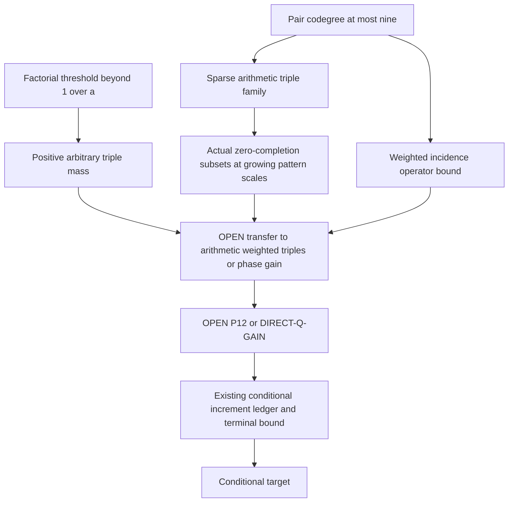

# Growing overlap systems: sparse triple geometry and incidence energy

24 October 2026. **D: new rigorous partial results. Target OPEN.**
No literature novelty is asserted. The October 21 closure remains withdrawn.

## 1. Setting, recheck, and factorial-moment threshold

Use p>3 prime, P=1_Omega, B=1_A, w=|Omega|/p, a=|A|/|Omega|,
alpha=aw, u=B-aP, and the original mixed-host tent F with 0<=F<=1.
A is cyclically nonzero-four-AP-free. All direction sums, including those
restricted to h!=0, retain factor 1/p. Exactly

    a^4T+R1+R2+R3+R4=aw/p,
    q_j(v)=P(v)E_h 1_(h!=0)F(v-jh,h) product_(i!=j)B(v+(i-j)h),
    q=sum_j q_j, m=E_Omega q, Bq=0,
    wm=M3*=M3-4aw/p.                                  (G1)

The [previous overlap proof](OVERLAP_CONSTRAINTS_20261023.md) can be rechecked
without translating the host. For each fixed v, put
E(h)=B(v+h)B(v+2h)B(v+3h), M(h)=B(v-h)B(v+h)B(v+2h).
If E(h)=M(2h)=1, the four vertices v+h,...,v+4h are occupied;
therefore E(h)+M(2h)<=B(v+2h). Sum over nonzero h, pair the unweighted
reverse channels, and only then use F<=1. This gives q(v)<=2alpha,
m<=2alpha(1-a), and Var_Omega(q)<=2alpha m-m^2. No weighted channel
is identified with its reversal. The proof is valid on proper mixed hosts.

For arbitrary Boolean variables B_1,...,B_n, let X=sum_i B_i.
If E B_i=a and E B_i B_j=a^2 for distinct indices, then
EX=na and E X(X-1)=n(n-1)a^2. If X<=2 almost surely,
X(X-1)<=X gives (n-1)a<=1 when a>0. For a=0 no division is needed.
This is the exact threshold for the previous local law.

Without X<=2, the always-valid replacement is

    3 E binom(X,3) >= E X(X-1)-EX.                    (G2)

Proof: for integers k>=0, k(k-2)<=3 binom(k,3). Check k=0,1,2;
for k>=3 the difference is k(k-2)(k-3)/2>=0.
Thus beyond the local-law threshold, positive TOTAL triple mass is forced.
It is not necessarily mass of triples admitting a four-AP completion.
Approximate first and pair moments can be inserted directly into G2;
no independence assumption or replacement of their error terms is justified.

## 2. PC24: arithmetic pair-codegree bound for all growing systems

For any V subset F_p, let H(V) be the 3-uniform hypergraph whose edges
are triples contained in SOME nondegenerate four-AP in F_p. The fourth
vertex need not lie in V. This deliberately includes every possible
completion triple of any host or weight supported on V.

For a fixed pair x!=y, its possible third vertices are exactly

    x+(y-x)t, t in D modulo p,
    D={-2,-1,-1/2,1/3,1/2,2/3,3/2,2,3}.              (G3)

To prove it, place x,y,z in distinct slots i,j,k of a four-AP. Then
t=(k-i)/(j-i). Enumerating the 24 ordered choices gives D. Conversely
each such slot choice defines a nonzero direction (y-x)/(j-i) and a
completion. Denominators 1,2,3 are invertible for p>3. Modular collisions
can reduce the number of third vertices, but cannot increase it.

Therefore every pair-codegree is at most 9, and for n=|V|,

    |H(V)| <= 3 binom(n,2).                            (G4)

Each triple is counted by its three pairs. For n>2 this implies that
at most 9/(n-2) of all triples can even have the required arithmetic
shape (replace this by 1 if larger). The large-system factorial count
is therefore a count over a much larger collection than the completion
hypergraph. This bound is uniform in V, not just an interval model.

## 3. GI24: actual arithmetic zero-completion subsets beyond the local-law scale

Every V subset F_p of size n>=2 contains a subset S with no triple in
H(V) and

    |S| >= (2sqrt(2)/9) n/sqrt(n-1).                  (G5)

Proof: sample vertices independently with probability
t=sqrt(2/[9(n-1)])<=1. By G4, the expected number of sampled vertices
minus sampled hyperedges is at least
nt-3 binom(n,2)t^3=(2/3)nt. Some sample attains at least that value.
Delete one vertex from each remaining occupied hyperedge, processing
the original sampled edge list. At most one deletion per original
sampled edge is made and the final set is independent. This proves G5.

This is an actual arithmetic construction, not a local probability law.
It avoids every extendable triple even with completion vertices outside V,
so it is four-AP-free and its completion field vanishes for ANY enclosing
host and ANY nonnegative weight. For a subset S or a smaller subset of it,
G1 therefore has m=0. No assertion about its phase correlations follows.

In particular a desired occupancy of ceil(a n) is possible whenever
ceil(a n)<=ceil((2sqrt(2)/9)n/sqrt(n-1)). Ignoring integer rounding, the
sufficient condition is a^2(n-1)<=8/81. Thus this construction applies,
for sufficiently small a, at n of order 1/a, (1/a)log(1/a), and
 a^(-1-delta) for each fixed 0<delta<1. All triples are not forced to
vanish by AP exclusion; rather these examples deliberately avoid the
sparse arithmetic triple family and may contain many other occupied triples.

This defeats a proposed deterministic contradiction based only on growing
pattern size and zero completion. It does NOT preserve the exact first/pair
moments of CL23, does NOT satisfy failed selection automatically, and does
NOT give an eligible asymptotic counterexample. In a full host the guaranteed
density is only of order p^(-1/2), far below epsilon/log p. Small interval
patterns inside an eligible host do not transfer their density or absence
of triples to the entire host.

An explicit finite witness is p=17, S={0,1,4}. The value 4 is absent from
D modulo 17, so this sole occupied triple has no four-AP extension.
For the full host and F=1, q=0 and X=3 on the entire 17-point vertex set.
This refutes the weakened assertion that zero completion implies X<=2.
It is not an eligible counterexample to DIRECT-Q-GAIN or P12.

## 4. IE24: a weighted arithmetic incidence-operator inequality

Define the hypergraph weights, independently of A, by

    omega(S)=p^(-2) sum_(x,h!=0,j: {x+ih:i!=j}=S)
                                     F(x,h) product_(i=0)^3 P(x+ih).

Then sum_(S subset A, |S|=3) omega(S)=wm exactly. Multiplicities and all
four anchor slots are retained. There is no appeal to translation invariance.

Define a nonnegative matrix K with rows v in Omega and columns unordered
pairs c subset A. For every oriented nonzero progression with exactly three
occupied vertices, missing vertex v in Omega, add F(x,h)/p to K(v,c) for
each of the three occupied pairs c. No other increments are made.
Then

    sum_c K(v,c)=3q(v)<=6alpha,
    sum_v K(v,c)<=12/p.                               (G6)

The row equality follows from the definition of q and AP exclusion.
For the column bound, put the two FIXED distinct pair vertices into distinct
slots of a progression. There are 4*3=12 ordered choices, each determining
x,h uniquely. Because A is four-AP-free, each such progression has at most
one missing slot when it contributes (exactly three occupied vertices).
Its contribution to this column is at most 1/p. This counts ordered
progressions and remains valid when different choices give the same
unordered edge, even at small primes.

For every complex vector f on occupied pairs, with unnormalized counting
Euclidean norms, weighted Cauchy-Schwarz gives

    sum_v |sum_c K(v,c) f(c)|^2
        <= (72 alpha/p) sum_c |f(c)|^2.              (G7)

Indeed each row's square is at most its row sum times
sum_c K(v,c)|f(c)|^2; sum over v and use G6. This is a genuine arithmetic
operator bound for the weighted completion incidence system of any size.
It neither identifies a singular vector as a quadratic phase nor supplies
spectral concentration.

Applying G7 to the constant vector, and using q=K1/3, yields

    E_Omega q^2 <= 4 alpha^2(alpha-1/p)/w.

Together with the earlier degree bound,

    E_Omega q^2 <= min(2alpha m,
                              4alpha^2(alpha-1/p)/w). (G8)

These are UPPER bounds. Hole support still yields the separate lower bound
E_Omega q^2>=m^2/(1-a); it must not be reversed. Pair-correlation vectors
can be inserted in G7, but a bound translating them into quadratic phases
with sufficient coefficients is still missing.

## 5. Failed routes, explicit loss terms, and the low-mean branch

Attempt 1: use the n~1/a factorial threshold to force completion mass.
G2 forces arbitrary triples only. Splitting them into H(V) and its complement
leaves the unbounded term
E sum_(S notin H(V), |S|=3) product_(v in S) B(v).
GI24 shows this term can contain all occupied triples on actual arithmetic
sets. Discarding it would be false. The exact first/pair moments remain an
additional hypothesis, and a global argument connecting them to arithmetic
triple mass has not been proved.

Attempt 2: use incidence energy to close the low-mean branch. If
m<=2a^3T/w and T is asymptotic to wmu, G8 gives the existing scale
E q^2 <= (4+o(1))wmu a^4. A lower bound m^2/(1-a) does not contradict
this. At m of order mu a^3, G8's new independent term is of order a^3w^2,
usually weaker than the old term of order a^4wmu. The operator theorem
therefore supplies no uniformly diverging improvement over a^(3/2).

Attempt 3: delete occupied heavy completion triples. For any lambda>0,
let H_lambda={S: omega(S)>=lambda/p^2}. There are at most
p^2wm/lambda occupied edges of H_lambda, so deleting at most that many
vertices removes all of them. To guarantee deletion of o(|A|) through
this bound requires m=o(a lambda/p), much smaller than the current
low-mean hypothesis m<=2a^3T/w. For a fixed triple, placing a fixed pair into ordered progression slots
also gives omega(S)<=12/p^2. Thus any nonempty heavy family has lambda<=12;
on reachable hosts pa^2mu diverges, so the stated low-mean threshold
does not supply the deletion estimate. Light triples and their weights remain;
this is not a removal theorem for the original full completion system.
No unproved lower bound for F or omega has been inserted.

The exact residual relation is still

    R3+R4=aw/p-a^4T-R1-R2.                            (G9)

Eliminating m or inserting the one-sided energy estimates above does not
produce the required lower bound. No cubic term is discarded; the full
identity awm=4a^4T+3R1+2R2+R3-4a^2w/p remains in force.
No new boundary estimate is claimed: the original erosion losses and the
explicit weight-loss term from OD23 remain uncontrolled at the needed scale.

## 6. Exact remaining task and dependencies

The original eligible domain is r>=1,
r[log(1/w)+log(48r)+loglog p]<=log p/100,
epsilon/(2log|Omega|)<=a<=4/5, with a specified mixed linear/quadratic
interval presentation. The phase family is e_p(cx^2+tx), (c,t)!=(0,0), and

    delta=max |E_Omega (B-a)e_p(-cx^2-tx)|.

The sufficient uniform target is delta>=c_epsilon a^(3/2)F_epsilon(a),
where F_epsilon>=1 tends to infinity as a->0 and is chosen before the
instance. Equivalently one may prove P12 under failed adequate selection:
R3+R4>=-a^4wmu/2, or W8: E_F<=2U^2+2R3+a^4wmu.
None is established here. Total triple mass, operator norm, quadratic
energy and single-phase correlation are different quantities.

Next specific attempt: apply K to a centered occupied-pair function,
retaining the missing-triple term, and seek a phase-sensitive bilinear
estimate under failed selection. It must yield a uniform divergence in
delta/a^(3/2) or control the full signed residual. Merely increasing the
number of vertices does not resolve the demonstrated coverage deficit.

## 7. Verification scope

[Verifier](../../verification/scripts/verify_growing_overlap_20261024.py)
uses exact integer/Fraction arithmetic: independent enumeration of the nine
third-vertex ratios, actual completion fields, separately grouped incidence
matrices, row/column bounds, Schur energy for test vectors, and the full
weighted diagonal/residual identity. Finite tests support the proofs;
they do not replace the general arguments. No external peer or subagent
audit was used. All small-prime weights are explicitly outside the certified
eligible asymptotic regime; no eligible counterexample is claimed.

The dedicated run passed 43,045 exact assertions across 982 arithmetic instances, including 745 zero-mean instances. Geometry was checked at primes 5,7,11,13,17,19,29; the arithmetic weighted tests use primes through 17.

All 36 selected suites passed (23 current and 13 legacy), in an isolated copy using Python 3.14.9 and NumPy 2.5.4. The [saved run manifest](../../history/verification_20261024_growing/summary.json) and adjacent logs preserve outputs and source hashes. Passing historical finite diagnostics does not restore withdrawn analytic claims.
