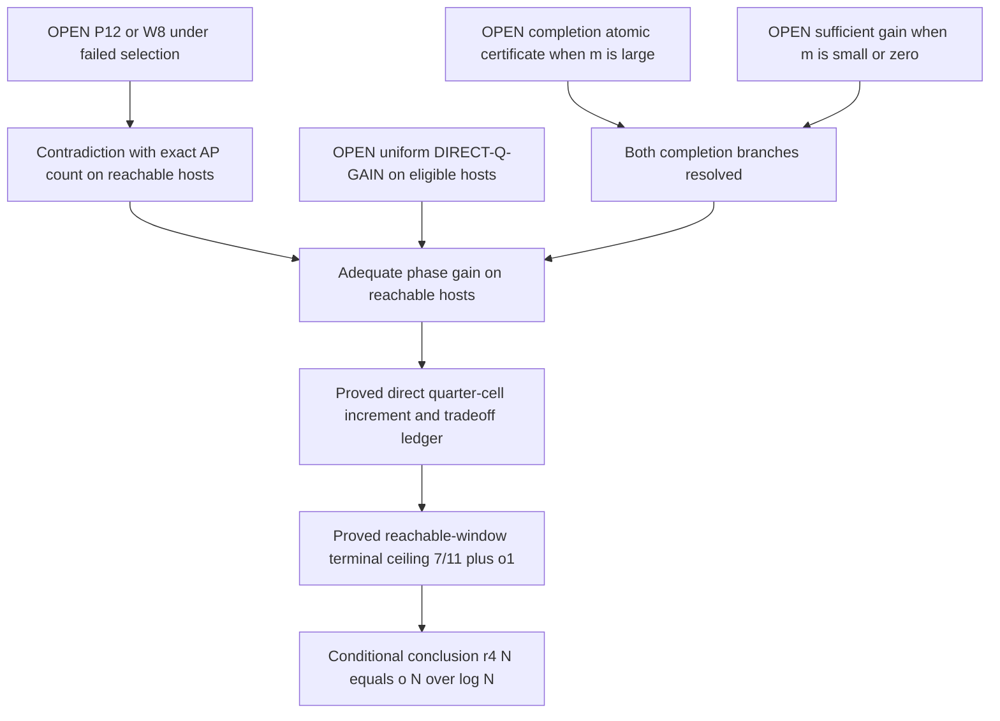

# Low completion mean: exact moment cone and valid variance bounds

23 October 2026. **D: new rigorous partial results; target OPEN.**
No literature novelty is asserted. The October 21 closure remains withdrawn.
This note adds a sharp completion-mean interval and a zero-mean local model,
not an eligible-host counterexample or a phase-selection theorem.

## 1. Reconstructed normalization and shortest route

Use the exact mixed host and original tent of
[M16](MIXED_QUADRATIC_TERMINAL_20261016.md): p>3 prime, P=1_Omega,
w=|Omega|/p, B=1_A, a=|A|/|Omega| in (0,1), u=B-aP.
A excludes every cyclic four-term progression with nonzero difference.
The conditional factor here is trivial: g=aP, not an arbitrary structured g.
The host has r=d+s interval constraints and k=d+2s tent factors;
H=floor(a^2 wp/(48r log p)), and the following asymptotic route uses H>=1.
F is their product, 0<=F<=1, F(x,0)=1. Its exact positive expansion is

    F(x,h)=sum lambda(C,beta,N)e_p(2Cxh+Nh^2+beta h),
    lambda>=0, sum lambda=1, mu=lambda(0,0,0)>0.

Write P_i=P(x+ih), u_i=u(x+ih). Precisely,

    T=E_(x,h) F product_i P_i,
    R_j=a^(4-j) E_(x,h) F sum_(|S|=j) product_(i in S)u_i
                                               product_(i notin S)P_i.
    a^4 T+R_1+R_2+R_3+R_4=aw/p.                     (L1)

All E_p and E_(p,p) averages are normalized. Set U=wa(1-a).
The diagonal pieces are T_diag=w/p, R1_diag=0,
R2_diag=6a^2 U/p, R3_diag=4a(1-2a)U/p,
R4_diag=(1-3a+3a^2)U/p. Their sum with a^4 w/p is aw/p.
An asterisk means restrict the defining average to h!=0.

The exact completion fields are

    q_j(v)=P(v) E_h 1_(h!=0) F(v-jh,h)
                         product_(i!=j) B(v+(i-j)h),
    q=sum_(j=0)^3 q_j, m=E_Omega q.

Thus Bq=0 and wm=M3*, where Mj*=E F 1_(h!=0) product P_i binom(K,j),
K=sum_i B_i on host edges. In particular wm=M3-4aw/p.
The full cubic term cannot be discarded:

    awm=4a^4T+3R1+2R2+R3-4a^2w/p.                  (L2)

The eligible DIRECT-Q-GAIN domain is the specified mixed-host presentation
with r>=1, r[log(1/w)+log(48r)+loglog p]<=log p/100 and
 epsilon/(2log|Omega|)<=a<=4/5. Put

    delta=max_(c,t)!=(0,0) |E_Omega (B-a)e_p(-cx^2-tx)|.

The sought theorem uniformly supplies delta>=c_epsilon a^(3/2) F_epsilon(a),
with F_epsilon>=1 and F_epsilon(a)->infinity. The constants and function
precede the choice of instance. For a prescribed function its failed-selection
antecedent is the strict reverse inequality. Failure for a single function
is not failure for every divergent function. The exact general negation is
in [QC17](O2_QUANTIFIERS_CUBIC_BOUND_20261017.md); after the recorded qualitative
positive-density reduction, it requires an eligible a_n->0 sequence with
bounded delta_n/a_n^(3/2).

On the reachable domain the established estimates are
T=(1+o(1))wmu, R1=o(a^4wmu), R2>=-o(a^4wmu), pa^3mu->infinity.
Consequently L1 gives R3+R4<=-(1-o(1))a^4wmu. P12 would contradict this
if, UNDER failed selection on that same domain, it proved

    R3+R4>=-a^4wmu/2.                                (P12)

The exact covariance identity R4=U^2-E_F/2 makes this equivalent to
E_F<=2U^2+2R3+a^4wmu (W8). The covariance definition is in
[WQ18](WEIGHTED_QUARTIC_COVARIANCE_20261018.md); it is not total spectral energy.

The two completion branches need the same uniform gain and exhaustive coverage.
For F(a)=loglog(e^2/a), the recorded ledger at a0=epsilon/log N has
rank O_epsilon(sqrt(L)/loglog L+log L) and log size loss
O_epsilon(sqrt(L)/loglog L+(log L)^2), L=log N; their product is o(L).
This preserves reachability and eventually contradicts the terminal bound.
Any uniformly divergent factor suffices by the epoch ledger in
[tradeoff](DIRECT_INCREMENT_TRADEOFF_20261016.md). No explicit effective rate
is restored here. Proving P12 alone does not establish spectral compression.

## 2. LM23: sharp finite occupancy interval for the completion mean

This theorem needs only AP exclusion and a nonnegative weight, not its
Fourier expansion. Put t0=T*, s1=M1*, s2=M2*, t3=wm.
Then

    max(0,(2s2-s1)/3) <= t3 <= min(s2/3,t0-s1+s2).     (L3)

Moreover these are the EXACT feasibility conditions for a nonnegative
one-edge occupancy measure with the specified t0,s1,s2,t3. They remain
valid when t0=0; no division by the edge mass is needed.

Proof. Let b_j be the weighted mass of nonzero host edges with K=j.
AP exclusion says j is in {0,1,2,3}. Direct inversion gives

    b3=t3, b2=s2-3t3, b1=s1-2s2+3t3,
    b0=t0-s1+s2-t3.                                  (L4)

Nonnegativity of these four numbers is exactly L3. Conversely, these
numbers define an occupancy measure with the prescribed moments. A
uniform distribution among patterns of each occupancy realizes it as a
four-bit law. This converse does NOT realize it on an arithmetic host.

A finite full-average consequence, keeping all diagonals, is

    3wm >= 4a(3a-1)T+(6a-1)R1/a^3+2R2/a^2-8aw/p.   (L5)

Indeed s1=4aT+R1/a^3-4aw/p and
s2=6a^2T+3R1/a^2+R2/a^2-6aw/p; insert into L3.
If |R1|<=E1 and R2>=-E2, its right side is at least
4a(3a-1)T-|6a-1|E1/a^3-2E2/a^2-8aw/p.
It forces a useful mean only above density 1/3 with controlled errors.
It supplies no positive mean at the logarithmic starting density.

## 3. ZM23: low-mean obstruction to one-edge positivity and SOS

For EVERY real 0<a<=1/3, a probability law on four Boolean coordinates
exists with every marginal a, every pair moment a^2, no occupancy 3 or 4,
and thus zero completion mean in the single-edge sense. Assign total masses

    b0=1-4a+6a^2, b1=4a-12a^2, b2=6a^2, b3=b4=0,

uniformly within each occupancy class. These are nonnegative and sum to 1.
The marginal is (b1+2b2)/4=a; each pair moment is b2/6=a^2.
For u_i=B_i-a and the same residual convention (unit edge mass),

    R1=R2=0, R3=-4a^4, R4=3a^4, R3+R4=-a^4.         (L6)

Proof: M1=4a, M2=6a^2, M3=M4=0, and substitute the exact Boolean
expansion, or expand each centered product directly. In particular the
quartic term is positive here, while the cubic term causes the obstruction.

More generally replacing the masses by
(1-4a+6a^2-t, 4a-12a^2+3t, 6a^2-3t, t) gives the exact interval L3,
with R3=at-4a^4 and R4=3a^4-at. Every 0<=t<=4a^3 is feasible for
a<=1/3. The proof follows from L4; at t=4a^3 the two potentially negative
masses are 6a^2(1-2a) and (1-a)^4-a^4, both nonnegative in this range.
Linearity handles the intervening t. Thus the whole low-mean interval
0<=t<=2a^3 is compatible with the obstruction, not just its zero endpoint.

This extends the October 17 one-edge obstruction specifically to zero
and low completion mean. Any purported universal one-edge SOS proof of
P12 from Boolean identities, exclusion of 1111, the first/pair moments,
and low triple mass alone fails on this actual nonnegative probability
law. This statement concerns only those premises. It has no quadratic
phase coefficients or eligible-host realization, and does not refute P12,
DIRECT-Q-GAIN, or the target. Arithmetic coupling between distinct edges
and the failed-selection hypothesis remain essential missing information.

## 4. VB23: a valid upper variance bound, with its limitation

Assume 0<=F<=1, p>3, and the actual Boolean AP-free setting above. Since
v+(i-j)h is a bijection of F_p for i!=j,

    0<=q_j(v)<=|A|/p=aw, hence 0<=q(v)<=C=4aw.

Here dropping all but one Boolean factor and restoring h=0 only enlarges
the average. The hole support Bq=0 gives m<=C(1-a). Define
z=q-m(1-B)/(1-a) on Omega. Then the exact projection and valid bounds are

    Var_Omega(q)=am^2/(1-a)+E_Omega z^2,
    Var_Omega(q)<=Cm-m^2,
    0<=E_Omega z^2<=Cm-m^2/(1-a).                    (L7)

Proof: q^2<=Cq pointwise, so E q^2<=Cm. Subtract m^2 and then use
orthogonality of z to B-a. This is a genuine upper bound, unlike the
withdrawn reversal of the projection lower bound.

It does not give the desired compression tolerance E z^2<=am^2/[4(1-a)].
The upper bound in L7 would guarantee that tolerance only if
m>=C(1-a)/(1+a/4), close to its largest possible value. At a proposed
completion scale m=c mu a^3 the ratio C/m=4w/(c mu a^2) is uncontrolled.
Even a small z would still require a small phase coefficient norm for
B-a; near-collinearity alone is not a phase-concentration theorem.

## 5. Arithmetic zero-mean implication and next bottleneck

Nonnegativity gives an exact assertion beyond the abstract model:
m=0 iff NO nonzero host edge with positive F has exactly three occupied
vertices. Equivalently all four allowed anchored triple types vanish.
In particular B(x)B(x+h)B(x+2h)=0 whenever h!=0,
P(x+3h)=1, and F(x,h)>0. This follows either pointwise from q3 or from
L4. For m>0 the total weighted mass of such endpoint triples is at most
wm. This is a statement about extendable, positively weighted triples;
it is NOT global three-AP-freeness. Boundary and weight support matter.

The recorded low-mean branch is m<=2a^3T/w. Its established direct cubic
estimate gives, with beta=(mu+p^(-1/2))b+1/p,

 delta >= [4a^3T-wm-3E1/a-2E2/a-4beta-4aw/p]_+
                                      /[4w^2a(1-a)]. (L8)

Even favorable errors yield only a^2 mu/w. Relative to the needed
a^(3/2)R(a), the factor is sqrt(a)mu/[wR(a)], not a divergent gain.
For the original radius beta/(a^3wmu) is not known to vanish at
a~epsilon/log p. L3 and L7 do not repair either deficit.

Next attack: exploit simultaneous extendable-triple restrictions across
many overlapping edges in the eroded mixed host, under failed quadratic
selection. A sufficient result must give delta>=c_epsilon a^(3/2)R(a)
throughout the low-mean branch, or directly establish P12/W8. Ordinary
one-edge moment inequalities and hole variance cannot supply it.

## 6. Adversarial checks and execution scope

Three proof attempts were completed: the full local moment linear program
(proved, but it admits the explicit zero-mean obstruction); the bounded
completion variance route (proved upper bound, quantitatively insufficient);
and zero-mean reduction to triple exclusion (proved only for allowed
extensions, insufficient for a global counting contradiction).

The independent computational derivation enumerates rational occupancy
laws and expands centered products from individual bit patterns. It also
constructs completion fields directly on finite cyclic AP-free sets and
compares their mean with separately counted occupancies. All checks use
Fraction arithmetic, including full diagonal subtraction and variance.
No subagent or external peer review was used in this cycle.

[Verifier](../../verification/scripts/verify_low_mean_moments_20261023.py)
and [result](../../verification/results/LOW_MEAN_MOMENTS_20261023.json):
26,477 exact assertions, 4,844 rational occupancy laws, 435 exchangeable
laws, 423 actual finite arithmetic cases (247 with zero mean).
The arithmetic tests use arbitrary bounded positive rational weights and
proper hosts to check universal lemmas; they do not satisfy a certified
T5/prescribed-radius domain and are not asymptotic counterexamples.

Full selected verification: all 34 suites passed (21 current, 13 legacy), using Python 3.14.7 and NumPy 2.5.4 in an isolated copy. [Saved run manifest](../../history/verification_20261023_low_mean/summary.json) and adjacent logs preserve the outputs. These include historical diagnostics whose stronger analytic interpretations remain withdrawn.
