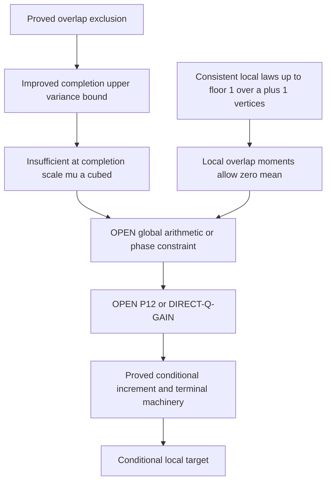

# Overlapping progressions: completion degree and a consistent local obstruction

23 October 2026, second cycle. **D: rigorous partial results. Target OPEN.**
The October 21 withdrawal remains in force. No literature novelty is claimed.

## Definitions and baseline

Use exactly P=1_Omega, B=1_A, w=|Omega|/p, a=|A|/|Omega|,
u=B-aP and the original mixed-host tent F from the
[previous note](LOW_MEAN_MOMENT_CONE_20261023.md). All restricted h sums
retain normalization 1/p. Here p>3 is prime and A is cyclically nonzero-4AP-free.
The counting identity remains a^4T+R1+R2+R3+R4=aw/p.
The completion fields are q_j(v)=P(v)E_h 1_(h!=0)F(v-jh,h)
product_(i!=j)B(v+(i-j)h), q=sum q_j, m=E_Omega q.
In particular Bq=0 and wm=M3*=M3-4aw/p.

The exact single-edge moment cone is
max(0,(2M2*-M1*)/3)<=wm<=min(M2*/3,T*-M1*+M2*).
Its zero-triple law has occupancy masses
(1-4a+6a^2,4a-12a^2,6a^2,0) for a<=1/3.
The new local law below extends that obstruction consistently across edges.

## OC23: classification and the joint occupancy polytope

Normalize a nonzero first difference d by translating and dividing by d.
The two ordered progressions become I={0,1,2,3} and J={z+rj:0<=j<=3},
where r=e/d!=0. Two distinct shared vertices i,k in I and positions j,l
in J force

    r=(i-k)/(j-l), z=i-rj; i!=k, j!=l.                (O1)

Conversely all overlaps of size at least two arise from this formula.
This is exact over F_p for every p>3: denominators 1,2,3 are invertible.
For one shared vertex, z=i-rj with all other coincidences excluded;
for zero shared vertices all sixteen coincidences are excluded. These
are parameterized families rather than a fixed finite list. The modular
formula handles repeated sets, reversal, and exceptional small primes.
Differences zero are excluded here and retained in the original diagonal
aw/p, not reclassified as nondegenerate overlaps.

Over Q, enumerating the at most 144 choices in O1 yields 54 ordered
normalized types: 48 with two common vertices, 4 with three, 2 with four.
Of the 48 two-vertex types, 20 contain a third distinct four-AP in their
union; 28 contain only the named two. The four three-vertex types have
two APs; the two repeated-set types have one. These finite counts are
exact enumeration results. We do not claim this rational histogram for
every p>3. The saved modular tables include p=5,7,11,13,17,223.

For V=I union J, let H(V) contain ALL nonzero four-AP subsets of V.
The exact Boolean occupancy polytope is the convex hull of incidence
vectors of subsets S of V containing no member of H(V). Joint moments
are the linear images E product_(v in D) B(v)=sum_(S containing D) pi_S,
with pi_S>=0 and sum pi_S=1. This gives a finite exact description, not
an assertion that its projections have all been reduced to facets.

Named-edge exclusions alone are insufficient: take I={0,1,2,3},
J={0,2,4,6}, S={1,2,3,4}. Neither named edge is contained in S, but
S is itself a four-AP. Thus cross-edge arithmetic imposes additional
joint Boolean constraints. The same example works over primes p>6.

Host boundary: these statements apply to actual vertices in the full
ambient field. In weighted host sums retain both host indicators and
both actual F factors. Dropping a host requirement or substituting a
reversed weight is not an equality. No erosion estimate is improved here.

## OD23: a factor-two improvement in the completion degree bound

For v in Omega define, with h!=0,

    E_v(h)=B(v+h)B(v+2h)B(v+3h),
    M_v(h)=B(v-h)B(v+h)B(v+2h), alpha=|A|/p=aw.

Pointwise AP exclusion proves

    E_v(h)+M_v(2h)<=B(v+2h),
    E_v(h)+E_v(2h)<=B(v+2h).                         (O2)

Indeed both indicators on either left side include B(v+2h). If both
were one, v+h,v+2h,v+3h,v+4h would be occupied. These four vertices
are distinct for every p>3, even when other union vertices collide.
Thus the indicators are mutually exclusive. This proves every sign.

Let e=E_h 1_(h!=0)E_v(h), b=E_h 1_(h!=0)M_v(h).
Since multiplication by 2 permutes nonzero directions, O2 yields

    e+b<=alpha-B(v)/p, 2e<=alpha-B(v)/p.

The four UNWEIGHTED anchor averages sum to 2(e+b): the other endpoint
and interior channel follow by h -> -h. Because 0<=F<=1, their weighted
sum is bounded above by this unweighted sum. Consequently

    0<=q(v)<=2aw, q0(v),q3(v)<=aw/2,
    m<=2aw(1-a), Var_Omega(q)<=2aw m-m^2.             (O3)

For the last two statements use Bq=0 and q^2<=2aw q pointwise.
The variance direction is an upper bound. No symmetry of F is used.
This improves VB23's constants from 4 to 2 on actual arithmetic sets.
It does not give a positive lower bound for m.

An exact slack decomposition keeps the weight cost visible. Put

    S(v)=E_h 1_(h!=0)[B(v+2h)-E_v(h)-M_v(2h)]>=0,
    L(v)=sum_j E_h 1_(h!=0)(1-F(v-jh,h))
                                     product_(i!=j)B(v+(i-j)h)>=0.

For v in Omega, with all anchor channels included,

    q(v)=2aw-2B(v)/p-2S(v)-L(v),
    m=2aw-2a/p-2E_Omega S-E_Omega L.                (O4)

Proof: subtract exactly the lost weight from the unweighted four-channel
sum, then use the definition of S. Low m forces large combined slack and
weight loss; it does not identify which term dominates. In particular L
cannot be dismissed as an eroded-host boundary error: the tent may be
small even where the host indicator is one.

## CL23: consistent local laws survive all fixed-size overlap constraints

Let n>=2 and 0<=a<=1/(n-1). On any set V of n labelled vertices assign

    Pr(S=empty)=1-na+binom(n,2)a^2,
    Pr(S={v})=a-(n-1)a^2 for each v,
    Pr(S={v,t})=a^2 for each unordered pair,
    Pr(|S|>=3)=0.                                    (O5)

These form a probability law. Singletons are nonnegative. The empty
mass quadratic has minimum at a=1/(n-1), with value (n-2)/(2(n-1)).
Summing all masses gives one. Each marginal is a and each pair moment a^2.

For W subset V of size k, marginalizing gives the SAME law O5 with n
replaced by k: a singleton gains (n-k)a^2 from pairs crossing W; each
pair retains a^2; the empty mass follows by subtracting the others from
one. Thus laws on every set of at most n vertices are mutually consistent
on intersections. For k=0,1 use the evident empty/Bernoulli laws.

Every realized subset has at most two occupied vertices, so it avoids ALL
four-APs and all triples on its local domain, including cross-edge APs.
On any four coordinates, direct expansion gives
R1=R2=0, R3=-4a^4, R4=3a^4 and R3+R4=-a^4.

For two overlapping four-APs the union has at most seven vertices, so
for a<=1/6 these local laws simultaneously defeat any inference of a
positive triple mean from the local joint polytopes and exact first/pair
moments alone. Even disjoint pairs fit n=8 and a<=1/7. More generally
this construction works up to n=floor(1/a)+1 vertices.

This is a family of consistent local probability laws, NOT a global
Boolean set of density a on F_p. Extending O5 to p vertices would need
a<=1/(p-1). At a of order 1/log p that condition fails. No prescribed
phase correlations, global density concentration, or eligible-host
realization is asserted. It is not a counterexample to DIRECT-Q-GAIN.
Nor does it rule out methods using global positivity constraints that
do not follow from these finite marginal laws.

## Quantitative audit and exact remaining task

The two substantive routes have different outcomes. Arithmetic overlap
exclusion genuinely improves the completion cap (OD23); its slack identity
has a large uncontrolled weight-loss term. The local moment route remains
feasible at zero mean even after adding all cross-edge exclusions (CL23).

With z=q-m(1-B)/(1-a), O3 and the exact projection give
E z^2<=2aw m-m^2/(1-a). To force E z^2<=am^2/[4(1-a)] from this upper
bound when m>0 would require
m>=2aw(1-a)/(1+a/4), near the maximum allowed mean. At m of order mu a^3,
the ratio 2aw/m is of order w/(mu a^2). The improvement is a constant,
not the uniformly divergent phase gain required by the iteration.
Neither a near-collinear completion field nor total energy proves phase
concentration. No sufficient replacement theorem is established.

The exact target remains P12 under failed selection:
R3+R4>=-a^4wmu/2, equivalently E_F<=2U^2+2R3+a^4wmu.
Alternatively prove delta>=c_epsilon a^(3/2)F_epsilon(a) uniformly on the
original eligible domain, F_epsilon(a)->infinity. The low-mean branch
m<=2a^3T/w is still open, including m=0. All original diagonals, host
erosion errors and Fourier normalizations from the previous note remain.

Next attack: a density-dependent family of overlapping progressions beyond
the O(1/a)-vertex local-law range, with global consistency or phase failure
providing a quantitative constraint. Merely enumerating another fixed
small overlap cannot remove O5. A certificate must control the full
cubic-plus-quartic residual or yield the stated uniform phase gain.

## Verification and limitations

The [verifier](../../verification/scripts/verify_overlap_constraints_20261023.py)
uses exact Fraction/integer enumeration for classification, local-law
marginalization, cross-edge exclusions, weighted slack, degree, variance,
completion normalization and the full residual identity on finite AP-free
sets. Explicitly labeled phase diagnostics use floating complex arithmetic.
The finite examples fail T5 and use positive H where the prescribed radius
is zero; none refutes an eligible asymptotic theorem. No subagent or external
peer audit was used. The proof above was checked by direct rederivation;
finite enumeration supports it and does not replace its general argument.

The saved run contains 293,771 exact assertions on 1,056 actual finite arithmetic instances (1,040 in the tested low-mean branch), plus nine floating phase diagnostics.

All 35 selected suites passed (22 current, 13 legacy) under Python 3.14.7 and NumPy 2.5.4 in an isolated copy. [Run manifest](../../history/verification_20261023_overlap/summary.json) and adjacent logs preserve outputs and script hashes. Historical diagnostic success does not reinstate withdrawn analytic conclusions.
